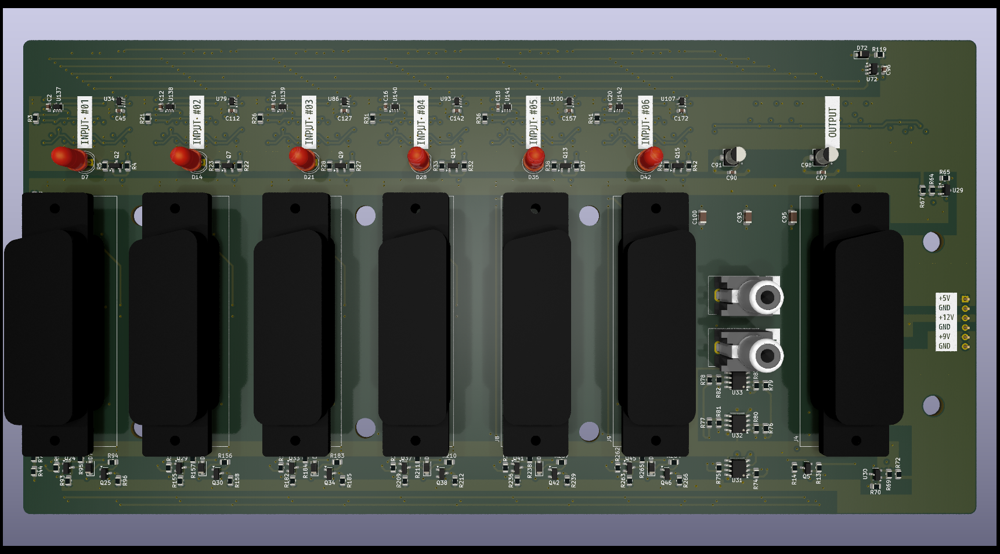
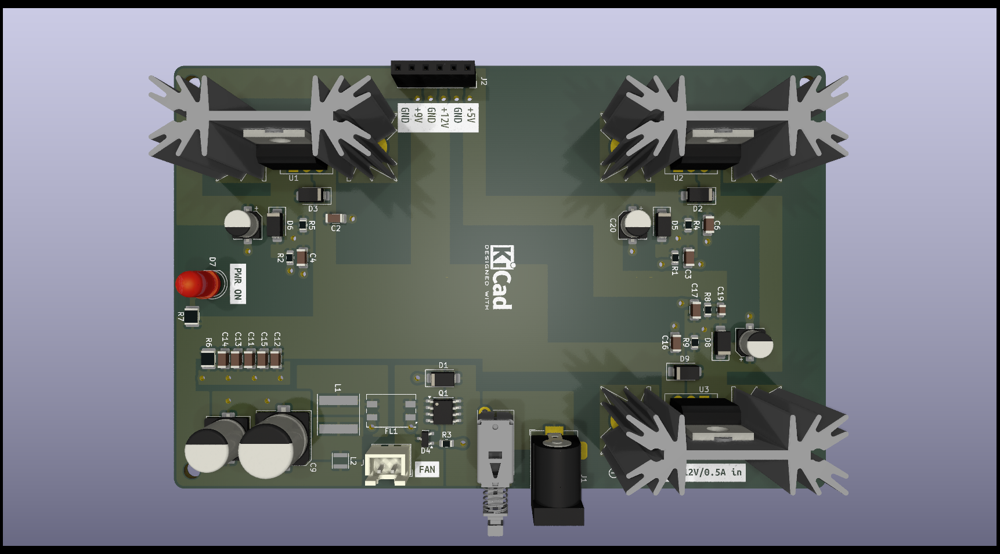

# SCART switcher

A work-in-progress hardware design for switching SCART video and audio. The repository contains KiCad schematics and PCB layouts for the main switcher and a separate power-supply board, along with fabrication exports and mechanical CAD models.

> **Status:** The repository does not document prototype bring-up, measured performance, or production readiness. Treat the design and existing fabrication files as work in progress; review and validate them before ordering boards or connecting equipment.

## Design overview

The schematics and board layout describe:

- Six SCART inputs and one SCART output.
- Analog video/RGB and stereo audio input and output stages.
- Priority-based input selection using SCART input-active/function signaling.
- RCA left/right audio outputs.
- A separate power-supply board, intended to keep power-circuit changes from requiring a respin of the larger switcher board.
- A “silent input” path in the main schematic, implemented as a dummy audio/video input.

The separate supply schematic describes a 12 V DC input, a 5 V rail rated for up to 300 mA, a 9 V rail rated for up to 100 mA, and a 12 V fan connection. Check the schematic and the exact assembly requirements before selecting a supply or fan.

## Repository contents

| Path | Contents |
| --- | --- |
| [`ECAD/SCART_switcher/`](ECAD/SCART_switcher/) | Main KiCad project, schematics, PCB, BOM, PDFs, renders, STEP model, and Gerber/drill exports |
| [`ECAD/Power_supply/`](ECAD/Power_supply/) | Separate power-supply KiCad project and its corresponding design and fabrication files |
| [`CAD/`](CAD/) | FreeCAD assembly, SCART connector models, standoffs, and heatsink models |
| [`ECAD/README.md`](ECAD/README.md) | Note on why the power circuitry is on a separate board |

Custom footprints and symbols are kept alongside the ECAD projects. Keep the included library tables and custom library folders available when opening the projects in KiCad.

## Viewing and editing

Open the relevant `.kicad_pro` file in KiCad:

- Main switcher: [`SCART_switcher.kicad_pro`](ECAD/SCART_switcher/SCART_switcher.kicad_pro)
- Power supply: [`Power_supply.kicad_pro`](ECAD/Power_supply/Power_supply.kicad_pro)

The corresponding `.kicad_sch` and `.kicad_pcb` files are the editable schematic and board sources. PDFs are convenient for browsing, while the top/bottom images and STEP files provide visual and 3D references.

## Board previews

### Main switcher

### Power supply

## Existing design outputs

Both projects include BOM CSVs, schematic PDFs, 3D board models, and zipped Gerber/drill packages:

- [Main switcher BOM](ECAD/SCART_switcher/SCART_switcher-BOM.csv) · [schematic PDF](ECAD/SCART_switcher/SCART_switcher.pdf) · [Gerbers ZIP](ECAD/SCART_switcher/Gerbers/SCART_switcher.zip)
- [Power-supply BOM](ECAD/Power_supply/Power_supply-BOM.csv) · [schematic PDF](ECAD/Power_supply/Power_supply.pdf) · [Gerbers ZIP](ECAD/Power_supply/Gerbers/Power_supply.zip)

These are checked-in outputs, not a guarantee that they match the latest editable design. Regenerate them from the reviewed project revision before fabrication.

## Before fabrication or use

Suggested next steps:

1. Run KiCad electrical-rule checks and PCB design-rule checks on both projects; review and resolve or document exceptions.
2. Verify that generated Gerbers, drill files, BOMs, and assembly data correspond to the final schematic and PCB revisions.
3. Confirm component availability, substitutions, connector pinouts, mechanical clearances, and the intended enclosure. The CAD folder contains component and assembly models, but the repository does not describe a finalized enclosure.
4. Bench-test the supply rails and thermal behavior, then test switching, video levels/termination, audio performance, and SCART control signaling with suitable equipment.
5. Add measured results, known limitations, operating instructions, and build/assembly guidance here once they are established.

No electrical, thermal, signal-quality, or compatibility measurements are claimed by this README.
